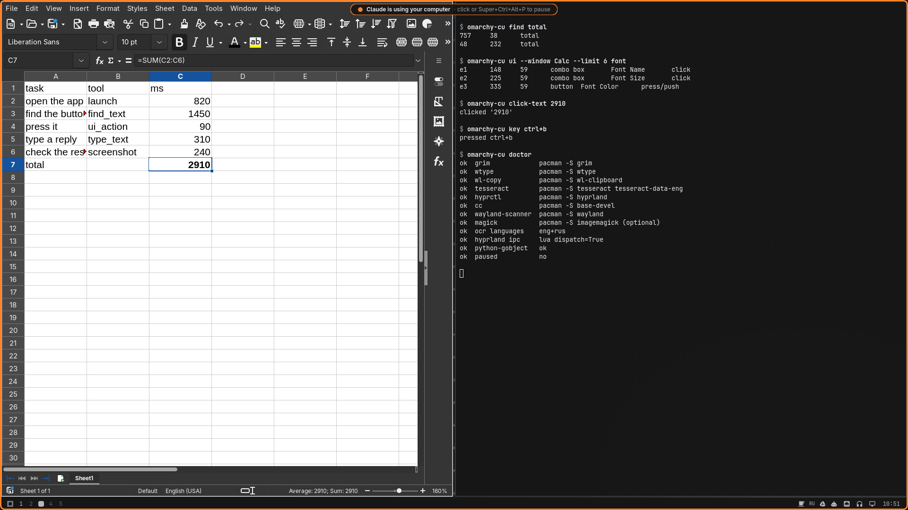

# omarchy-computer-use

computer use for ai agents on [omarchy](https://omarchy.org) and hyprland.

your agent gets eyes and hands on the desktop: screenshots, mouse, keyboard, on-screen text (ocr), the accessibility tree, windows, workspaces, apps and the whole `omarchy` command center. it ships as a [claude code](https://claude.com/claude-code) plugin, and works with any other mcp client (codex, opencode, …) or straight from the shell.

no root, no `ydotool`, no daemons. it runs on a stock omarchy install.



## features

* **sees the screen**: screenshots of a monitor, all monitors or one window, with the cursor drawn in and a text summary of every visible window. `zoom` reads small text.
* **finds things by name, not by pixels**: `click_text "Save"` runs ocr and clicks the label. `ui_tree` reads the accessibility tree of gtk, qt and chromium apps and clicks buttons by id, without even moving the mouse.
* **mouse and keyboard that just work on wayland**: a native virtual pointer (a tiny c helper, built on first use), `wtype` for unicode typing on any layout, real key combos and sequences.
* **knows hyprland**: windows, workspaces, float / tile / fullscreen / move / resize / pin, launching apps by name like the launcher does. supports the new lua dispatch syntax (hyprland 0.55+, current omarchy) and the old one.
* **knows omarchy**: ~400 system commands (themes, audio, display, wifi, toggles, …) are searchable and runnable, plus native popups to ask you a question and desktop notifications.
* **one coordinate space**: every tool uses the pixels of the screenshot it returned. hidpi, fractional scaling and several monitors are mapped for you.
* **you always know it's on**: a thin frame in your theme's color and a "claude is using your computer" pill while the agent acts. it hides itself for every capture, so it never ends up in the agent's screenshots.
* **a kill switch**: click the pill or press `super + ctrl + alt + p` and all agent input stops until you resume.
* **it won't hit its own terminal**: keystrokes into the agent's own window are refused, so a stray `escape` can't interrupt the agent itself.
* **reads russian too**: ocr in english and russian out of the box, more languages with one package.

## requirements

* [omarchy](https://omarchy.org), or arch linux with hyprland. other wlroots compositors are not supported (window control talks to the hyprland socket).
* python 3 with `python-gobject`. the cli and mcp server use only the standard library, gobject is needed for the accessibility tree and the indicator.
* claude code, if you want the plugin. any mcp client otherwise.

### dependencies

all from the official arch repos. `install.sh` installs whatever is missing, most of it ships with omarchy already.

| package | what for |
|---|---|
| `grim` | screenshots |
| `wtype` | keyboard |
| `wl-clipboard` | clipboard, long pastes |
| `tesseract`, `tesseract-data-eng`, `tesseract-data-rus` | ocr (`find_text`, `click_text`, `wait_for`) |
| `base-devel`, `wayland`, `pkgconf` | to build the virtual pointer helper (once) |
| `python-gobject`, `at-spi2-core` | accessibility tree (`ui_tree`, `ui_action`) |
| `gtk4`, `gtk4-layer-shell` | the on-screen indicator |
| `imagemagick` *(optional)* | sharper ocr on dark themes |

## install

```sh
git clone https://github.com/gloomyweather/omarchy-computer-use ~/.local/share/omarchy-computer-use
cd ~/.local/share/omarchy-computer-use
./install.sh --keybind
```

this:

1. installs the missing packages (asks for your sudo password if anything is missing),
2. builds the pointer helper,
3. links the cli to `~/.local/bin/omarchy-cu` and runs `omarchy-cu doctor`,
4. installs the claude code plugin (the `computer` mcp server and the `computer-use` skill) from the bundled marketplace,
5. with `--keybind`, binds the kill switch to `super + ctrl + alt + p` (your hyprland bindings file is backed up first).

then restart claude code. `/mcp` should list `computer`.

| flag | |
|---|---|
| `--keybind` | bind the kill switch |
| `--codex` | also register the mcp server with codex cli |
| `--no-claude` | skip the claude code plugin |

other ocr languages: `OMARCHY_CU_OCR_INSTALL="eng rus deu" ./install.sh`.

### claude code, by hand

```sh
claude plugin marketplace add ~/.local/share/omarchy-computer-use
claude plugin install omarchy-computer-use@omarchy-computer-use
```

### update

```sh
cd ~/.local/share/omarchy-computer-use && git pull && ./install.sh
```

## usage

### with claude code

just ask. the `computer-use` skill tells claude when and how to use the desktop:

```
open files and make a folder called "drafts" in documents
switch to the mono theme and show me how it looks
what's on my second monitor?
launch my app and check that the settings dialog opens without errors
put firefox on workspace 2 and the terminal next to it
```

a few things worth knowing:

* claude works on the screen you're looking at. it's best to give it its own workspace and watch, or to step away for a bit.
* when it needs you, it asks with a native popup instead of guessing.
* for web pages, claude prefers a browser tool (claude in chrome, playwright mcp, …) when one is connected, and uses computer use only for everything outside the page.
* you can always take over: move the mouse, type, or press the kill switch.

### with other agents

any mcp client: command `~/.local/share/omarchy-computer-use/bin/omarchy-cu`, args `["mcp"]` (stdio).

```toml
# codex: ~/.codex/config.toml (or ./install.sh --codex)
[mcp_servers.computer]
command = "/home/you/.local/share/omarchy-computer-use/bin/omarchy-cu"
args = ["mcp"]
```

```jsonc
// opencode.json
{ "mcp": { "computer": { "type": "local", "command": ["/home/you/.local/share/omarchy-computer-use/bin/omarchy-cu", "mcp"] } } }
```

`skills/computer-use/SKILL.md` doubles as an `AGENTS.md` snippet for agents without skills.

### from the shell

everything is also a cli command, handy for scripts and for agents that only have a shell. they can read the saved png files.

```sh
omarchy-cu screenshot                 # saves a png, prints its path + monitors and windows
omarchy-cu find "Sign in"             # ocr: center coordinates and boxes
omarchy-cu click-text "Sign in"
omarchy-cu click 640 360 --double
omarchy-cu type "привет, world"; omarchy-cu key ctrl+Return
omarchy-cu ui --window Files          # accessibility tree, then: omarchy-cu ui-do e12
omarchy-cu launch "chromium https://example.com"
omarchy-cu workspace 3
omarchy-cu ask "deploy now?" yes no   # native popup, prints the answer
omarchy-cu pause | resume | toggle    # kill switch
omarchy-cu doctor                     # checks every dependency
omarchy-cu --help
```

## mcp tools

| tool | what it does |
|---|---|
| `screenshot` | focused monitor, all of them or one window, with the cursor and a summary of the windows |
| `zoom` | magnified crop for small text and icons |
| `find_text`, `click_text` | ocr: exact coordinates of on-screen text, or click it |
| `ui_tree`, `ui_action` | accessibility tree, then click / focus / set text by element id |
| `click`, `move_mouse`, `drag`, `scroll`, `mouse_button` | pointer: any button, double / triple click, modifier-click |
| `type_text`, `key` | unicode typing on any layout, key combos and sequences |
| `windows`, `focus_window`, `close_window`, `workspace` | hyprland windows and workspaces |
| `window` | float, tile, fullscreen, maximize, move to workspace, move, resize, swap, pin |
| `apps`, `launch` | installed apps by name, or any command, and wait for the window |
| `omarchy`, `omarchy_commands` | search and run the omarchy command center |
| `ask_user`, `notify` | a native popup (pick a choice or type an answer), a notification |
| `wait_for` | wait until text or a window appears or disappears |
| `keybindings`, `clipboard`, `wait`, `hyprctl` | the small stuff |

action tools return a fresh screenshot by default, pass `screenshot: false` to skip it.

## safety

* nothing runs as root. there is no `uinput` device: the pointer and keyboard are ordinary wayland clients, like any app on your desktop.
* the indicator is on whenever the agent was active in the last 20 seconds. it turns red while paused.
* paused means paused: every input tool refuses until you resume (`omarchy-cu resume`, the pill, or the key).
* keystrokes into the agent's own terminal are refused. compositor binds like `super + 2` still work there.
* screenshots stay on your machine, in `/tmp/omarchy-cu`. what the agent sends to its model is up to the agent.

## config

environment variables, all optional:

| var | default | |
|---|---|---|
| `OMARCHY_CU_MAX_EDGE` | `1280` | long edge of the screen space and of screenshots |
| `OMARCHY_CU_AUTO_SCREENSHOT` | `1` | screenshot after actions |
| `OMARCHY_CU_SETTLE` | `0.35` | seconds to wait before that screenshot |
| `OMARCHY_CU_OCR_LANGS` | auto | every installed one of eng / rus / ukr / deu / fra / spa, or e.g. `eng+rus` |
| `OMARCHY_CU_INDICATOR` | `1` | the on-screen indicator |
| `OMARCHY_CU_IDLE` | `20` | seconds of inactivity before the indicator hides |
| `OMARCHY_CU_AGENT_NAME` | auto | name in the pill (`Claude` under claude code) |
| `OMARCHY_CU_COLOR` | theme accent | indicator color |
| `OMARCHY_CU_ALLOW_SELF` | `0` | allow keyboard input into the agent's own terminal |
| `OMARCHY_CU_OWN_WINDOW` | auto | address of the agent's own window, for terminals that run many windows in one process |
| `OMARCHY_CU_PYTHON` | `/usr/bin/python3` | interpreter for the cli and the mcp server (needs python-gobject) |
| `OMARCHY_CU_PASTE_WAIT` | `0.6` | seconds before `via_clipboard` restores your clipboard |

## troubleshooting

* **start with `omarchy-cu doctor`**. it checks every dependency and says what to install.
* **`ui_tree` is empty**: the app doesn't expose accessibility. gtk apps do. qt apps need `QT_LINUX_ACCESSIBILITY_ALWAYS_ON=1`, chromium and electron apps need `--force-renderer-accessibility`. ocr works everywhere else.
* **ocr can't read cyrillic** (or another script): install the language, e.g. `sudo pacman -S tesseract-data-rus`. no restart needed.
* **a `super + shift + …` bind doesn't fire**: binds with several modifiers often ignore virtual keyboards. use the native tools instead (`launch`, `window`, `workspace`, `omarchy`).
* **`/mcp` doesn't list `computer`**: restart claude code after installing, or run `./install.sh` again.

## how it works

```
.claude-plugin/   plugin.json (with the `computer` mcp server), marketplace.json
skills/           the computer-use skill: when and how the agent should use the desktop
bin/omarchy-cu    launcher: cli + `mcp` stdio server
src/omarchy_cu/   core.py     capture, input, ocr, hyprland, omarchy
                  a11y.py     accessibility tree (at-spi)
                  overlay.py  the indicator (gtk4 layer shell)
                  server.py   mcp server
                  cli.py      cli
helper/           hypr-pointer.c: zwlr_virtual_pointer_v1 client, built on first use
```

screenshots come from `grim`, scaled down to one "screen space" so the model always sees the same size. clicks are mapped back to real pixels per monitor. with imagemagick installed, ocr runs tesseract twice in parallel (as is, and upscaled, binarised and inverted for dark themes) and merges the words.

## uninstall

```sh
claude plugin uninstall omarchy-computer-use@omarchy-computer-use
claude plugin marketplace remove omarchy-computer-use
rm ~/.local/bin/omarchy-cu
rm -rf ~/.local/share/omarchy-computer-use ~/.cache/omarchy-cu
```

if you used `--keybind`, remove the "pause agent computer use" lines from `~/.config/hypr/bindings.lua` (or `bindings.conf`).

## license

[mit](LICENSE)

may your agent always click the right button (⌐■_■)
